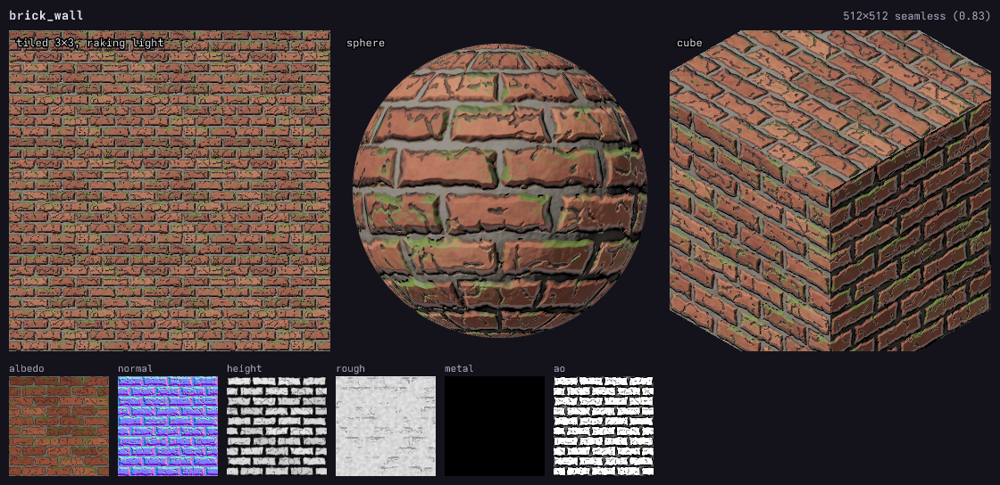
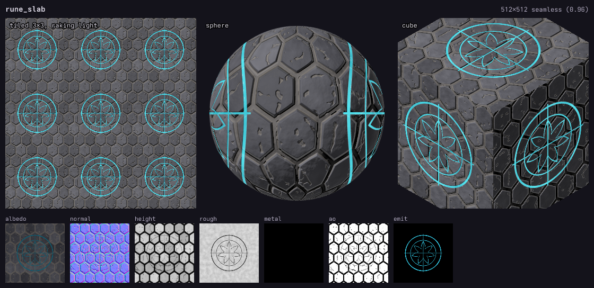
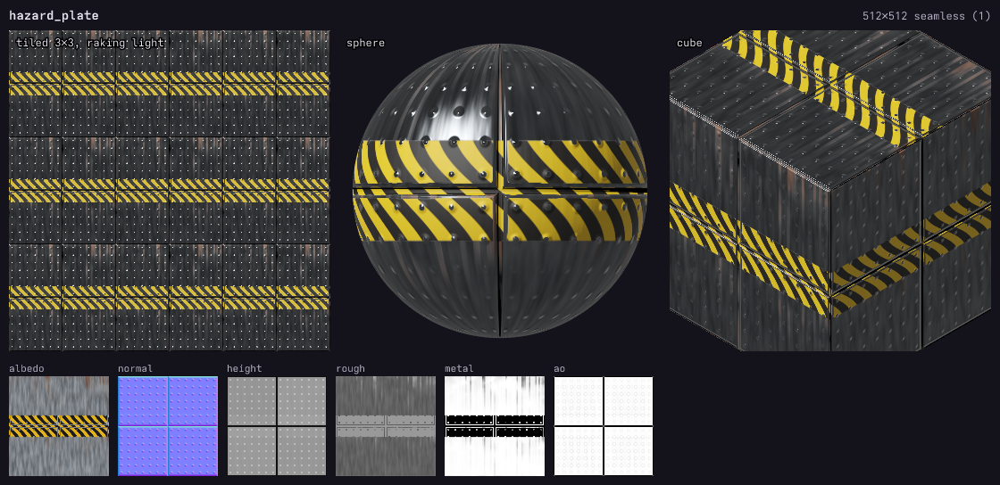

# loom

**Seamless game textures and PBR materials as code.** Write a small `.tx.js` file of fields
(noise, cells, bricks, planks, scales, ...) combined with operators and weathering masks; loom
writes every map an engine needs: albedo, normal, 16-bit height, roughness, metallic, AO, a packed
ORM and emissive. Every generator and operator tiles, so **materials are seamless by construction**,
and each build reports a seam check to prove it.

Built for AI agents (it ships as a Claude Code skill). Every build writes a **preview sheet**: the
material tiled 3×3 under a raking light, on a lit sphere and an isometric cube, and every map, so
the agent judges its textures the way it reads its code. A live viewer rebuilds on save.

Part of a family with [**vex**](https://github.com/uilianks/vex) (vector art, skeletal animation),
[**pxl**](https://github.com/uilianks/pxl) (pixel art), [**chirp**](https://github.com/uilianks/chirp)
(game audio) and [**kiln**](https://github.com/uilianks/kiln) (low-poly and voxel 3D). Inspired by
[**claude-pxl**](https://github.com/crsolver/claude-pxl), with the same architecture: sandboxed source
files, lazy cached builds, errors with exact locations, a live viewer and an annotate-and-send
feedback loop.

## In a 3D scene

[](https://github.com/uilianks/kiln#the-dragons-hoard-textured-with-loom)

*The Dragon's Hoard*, built in [**kiln**](https://github.com/uilianks/kiln) and rendered in Blender:
mossy brick, wet cobblestone, stained concrete, worn wood, rusted iron, glowing lava rock, dragon
scales and hammered gold, all from [`showcase/materials.tx.js`](showcase/materials.tx.js). A kiln
palette entry points at a loom output folder (`{ tex: "…/brick_wall", uv: 1.5 }`) and the GLB embeds
the albedo, normal, ORM and emissive maps.

## Showcase

Nine materials from [`showcase/materials.tx.js`](showcase/materials.tx.js), about 15 lines each.


Each one tiled 3×3: no seams.


| Material | Built from |
|---|---|
| brick_wall | `bricks` with wobble, chipped by thresholded `ridged`, grime in `cavity()`, moss on `facing("up")` |
| rusty_panels | `tiles` + rivets (`dots` along `.dist`), paint flaking from the edges, rust in the seams with `drips()` |
| wet_cobblestone | `cells().edge` stones, per-stone hue from `.id`, mud and puddles in the blurred gaps |
| wood_planks | `planks` with `.grain`, per-board tone, scuffs |
| scifi_panel | `tiles`, grooves, emissive light strips on some plates, scratches from stretched `ridged` |
| lava_rock | `cells` crust over glowing `emit` magma in the cracks |
| dragon_scales | overlapping `scales`, hue sheen per scale, metallic gold rims |
| stained_concrete | poured `noise`, pits, saw-cut seams, wet stains with low roughness |
| hammered_gold | `cells` dents hammered into the metal, tarnish in the hollows |

## Quick start

```bash
git clone https://github.com/uilianks/loom && cd loom
npm install
node bin/loom.js build showcase/materials.tx.js     # -> showcase/out/<name>/*.png + previews
node bin/loom.js serve showcase/materials.tx.js     # live viewer on http://127.0.0.1:4350
```

Requires Node ≥ 22.18 (it runs the TypeScript sources directly).

```js
pal({ brick: "#8e4a35", brickL: "#b46a4c", brickD: "#5e2c22", mortar: "#9c968a", grime: "#2b2622", moss: "#4c6a2c" })

const b = bricks({ rows: 10, cols: 4, gap: 0.014, bevel: 0.02, wobble: 0.5, seed: 3 })
const grain = noise({ scale: 24, octaves: 4 })
const height = b.mul(0.85).add(grain.mul(0.1))
const grime = height.cavity(0.006, 16).max(b.mask.invert().mul(0.5))
const moss = height.facing("up", 4).mul(noise({ scale: 6, seed: 9 }).threshold(0.58, 0.2)).mul(b.mask)

material("brick_wall", { size: 512, depth: 0.03 }, {
  height,
  color: ramp(b.id.mix(grain, 0.35), ["brickD", "brick", "brickL"])
    .mix("mortar", b.mask.invert()).mix("grime", grime.mul(0.6)).mix("moss", moss.mul(0.85)),
  rough: grain.levels(0, 1, 0.75, 0.95).mix(0.6, moss),
})
```

## Examples

Built by `npm run examples` from the files in [`examples/`](examples). Each picture is the build's
preview sheet: the material tiled 3×3 under a raking light, on a sphere and a cube, then every map.

**Weathered brick** ([`examples/basics.tx.js`](examples/basics.tx.js)): a pattern, noise, chips cut
by a thresholded ridged field, grime in the cavities and moss where the surface faces up.

```js
// loom basics: a brick wall built up from a pattern, noise and weathering masks.
pal({ brick: "#8e4a35", brickL: "#b46a4c", brickD: "#5e2c22", mortar: "#9c968a", grime: "#2b2622", moss: "#4c6a2c" })

const b = bricks({ rows: 10, cols: 4, gap: 0.014, bevel: 0.018, wobble: 0.5, seed: 3 }).as("bricks")
const grain = noise({ scale: 24, octaves: 4, seed: 2 }).as("grain")
const chips = ridged({ scale: 12, octaves: 3, seed: 5 }).threshold(0.86, 0.06).mul(b.mask).as("chips")

const height = b.mul(0.85).add(grain.mul(0.12)).sub(chips.mul(0.25)).as("height")
const grime = height.cavity(0.006, 18).max(b.mask.invert().mul(0.6)).as("grime")
const moss = height.facing("up", 4).mul(noise({ scale: 6, seed: 9 }).threshold(0.55, 0.2)).mul(b.mask).as("moss")

material("brick_wall", { size: 512, depth: 0.05 }, {
  height,
  color: ramp(b.id.mix(grain, 0.35), ["brickD", "brick", "brickL"]).mix("mortar", b.mask.invert())
    .mix("grime", grime.mul(0.7)).mix("moss", moss.mul(0.85)),
  rough: grain.levels(0, 1, 0.75, 0.95).mix(0.6, moss),
})
```



**Carved, glowing runes** ([`examples/rune_slab.tx.js`](examples/rune_slab.tx.js)): hex basalt with
`shape()` decals (rings, a star, spokes) cut into the height and lit through the emissive map.

```js
// A basalt floor slab with a glowing rune circle: hex tiles, shape() decals cut into the stone,
// and an emissive channel where the runes are carved.
pal({ basalt: "#3a3a40", basaltL: "#55555c", basaltD: "#222227", dust: "#6e665a", glow: "#38e0ff", glowD: "#0f5a6e" })

const h = hex({ cols: 6, gap: 0.035, bevel: 0.06, vary: 0.25, seed: 4 }).as("hex")
const grit = noise({ scale: 18, octaves: 5, seed: 6 }).as("grit")
const cracks = ridged({ scale: 7, octaves: 3, seed: 8 }).threshold(0.9, 0.04).mul(h.mask).as("cracks")

// The rune circle: two rings, a seven-point star and four spokes, all centred on the tile.
const rune = shape({ kind: "ring", r: 0.3, w: 0.014, soft: 0.003 })
  .max(shape({ kind: "ring", r: 0.215, w: 0.008, soft: 0.003 }))
  .max(shape({ kind: "star", r: 0.2, inner: 0.08, sides: 7, soft: 0.003 }).sub(shape({ kind: "star", r: 0.185, inner: 0.07, sides: 7, soft: 0.003 })).clamp(0, 1))
  .max(shape({ kind: "line", x0: 0.5, y0: 0.18, x1: 0.5, y1: 0.82, w: 0.008, soft: 0.003 }))
  .max(shape({ kind: "line", x0: 0.18, y0: 0.5, x1: 0.82, y1: 0.5, w: 0.008, soft: 0.003 })).as("rune")

const height = h.mul(0.8).add(grit.mul(0.12)).sub(cracks.mul(0.2)).sub(rune.mul(0.18)).as("height")
const dust = height.cavity(0.006, 14).max(h.mask.invert().mul(0.7)).as("dust")

material("rune_slab", { size: 512, depth: 0.045 }, {
  height,
  color: ramp(h.id.mix(grit, 0.45), ["basaltD", "basalt", "basaltL"]).mix("dust", dust.mul(0.55)).mix("glowD", rune),
  rough: grit.levels(0, 1, 0.7, 0.92).mix(0.35, rune),
  emit: ramp(rune.mul(noise({ scale: 5, seed: 3 }).levels(0.3, 0.7, 0.6, 1)), ["#000000", "glow"]),
})
```



**Painted metal** ([`examples/hazard_plate.tx.js`](examples/hazard_plate.tx.js)): tread-plate steel
(metallic, brushed roughness), a hazard band masked by a `rect` decal, paint worn off the raised studs
with `convex()`, and rust running down from the seams with `drips()`.

```js
// A tread-plate steel floor with a painted hazard band: a metal material (metallic + roughness),
// stripes masked by a rect decal, paint worn off the raised studs, rust bleeding down from the seams.
pal({ steel: "#7c8288", steelL: "#a9afb4", steelD: "#4b5055", yellow: "#e2b21c", black: "#1d1c1a", rust: "#7a3b1c" })

const plates = tiles({ rows: 2, cols: 2, gap: 0.006, bevel: 0.01, vary: 0.05, seed: 2 }).as("plates")
const studs = dots({ scale: 14, radius: 0.22, jitter: 0, soft: 0.25 }).as("studs")
const grain = noise({ scale: [40, 6], octaves: 3, seed: 5 }).as("brushed")

// Hazard band: diagonal stripes, only inside a horizontal strip across the middle.
const band = shape({ kind: "rect", cy: 0.5, w: 1.2, h: 0.22, soft: 0.004 }).as("band")
const diag = stripes({ count: 12, dir: "v", soft: 0.04 }).warp(stripes({ count: 1, dir: "h", soft: 1 }), 0.25).as("diag")

const height = plates.mul(0.6).add(studs.mul(0.25)).add(grain.mul(0.03)).as("height")
const worn = height.convex(0.006, 14).add(noise({ scale: 9, seed: 7 }).sub(0.5).mul(0.6)).threshold(0.45, 0.08).as("worn")
const paint = band.mul(worn.invert()).as("paint")
const rust = plates.mask.invert().drips({ length: 0.12, density: 0.35, seed: 9 }).mul(noise({ scale: 6, seed: 4 }).levels(0.3, 0.7)).mul(0.75).as("rust")

material("hazard_plate", { size: 512, depth: 0.03 }, {
  height: height.add(paint.mul(0.02)),
  color: ramp(grain, ["steelD", "steel", "steelL"]).mix("rust", rust).mix(ramp(diag, ["black", "yellow"]), paint),
  rough: grain.levels(0, 1, 0.3, 0.45).mix(0.85, rust).mix(0.6, paint),
  metal: paint.max(rust).invert(),
})
```



## Features

- **Generators**: fractal and ridged noise (stretchable for grain and streaks), Worley cells with
  edges and ids, dots, running-bond bricks, tiles, hexagons, planks with grain, overlapping scales,
  stripes, waves, basket `weave`, `checker` and `shape` decals (circle, rect, ngon, star, ring, line:
  markings, rims, runes, logos). Patterns expose `.mask`, `.id` (a random value per piece) and `.dist`.
- **Images in**: `image("photo.png", { seamless: 0.25 })` turns a photo or painted texture into a
  tiling color (edge-blended), and `.luma()` into a height map, to mix with generated detail.
- **Operators**: arithmetic, mix, levels, smoothstep, threshold, normalize, blur, domain warp,
  offset, repeat, quarter-turn rotate and flip, all wrapping at the tile edge.
- **Weathering from height**: `cavity()` for grime, `convex()` for worn edges, `facing("up")` for
  moss and dust, `drips()` for rust and rain streaks.
- **Maps**: albedo, tangent-space normal (GL or DX), 16-bit height, roughness, metallic, AO derived
  from height, ORM pack and emissive, plus a JSON manifest per material.
- **Seam check** on every build, and periods, repeats and rotations that would break tiling are refused.
- **Live viewer**: lit plane, sphere and cube with a draggable light, every map, every named field.
- **Annotate mode**: draw on the texture, pin notes and *send to Claude*; the feedback records what the
  material and every named field are at each marked pixel.
- **Errors** point at `file:line:col` with "did you mean" suggestions.

## Use as a Claude Code skill

```bash
git clone https://github.com/uilianks/loom && cd loom && npm install
ln -s "$PWD" ~/.claude/skills/loom-textures      # a link, so the skill is always this checkout
```

Then ask Claude for a material ("a mossy castle wall", "rusted ship hull", "a stylized grass tile").
[SKILL.md](SKILL.md) teaches the workflow and the habits that make materials read as real; the full
API is in [reference.md](reference.md).

## Development

```bash
npm run check          # type check + tests (seamlessness of every generator and op, normals, errors, outputs, feedback)
                       # + build every example and refresh docs/examples (npm run examples)
node scripts/gallery.ts  # regenerate docs/media/gallery.png and tiled.png
```

## License

[MIT](LICENSE). Inspired by and partly adapted from [claude-pxl](https://github.com/crsolver/claude-pxl)
by crsolver; see [NOTICE](NOTICE).

## Support

If this tool helps you, you can support its development on [Ko-fi](https://ko-fi.com/uiliankidricki).
